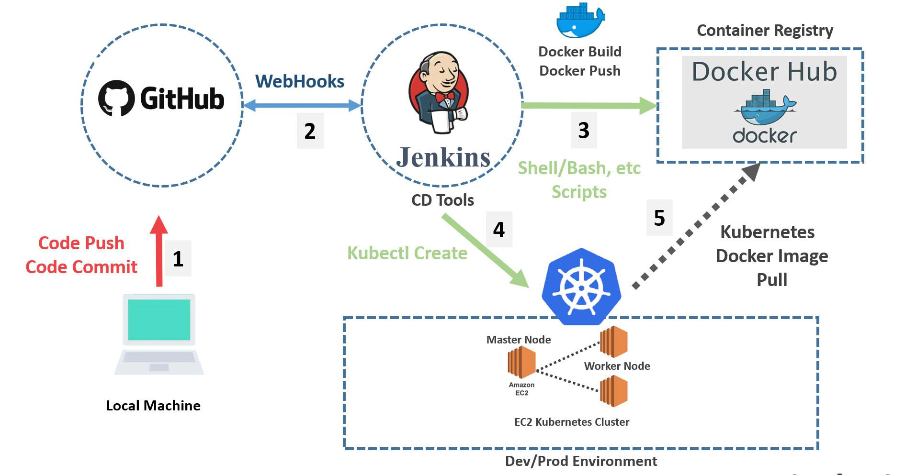

# Project 1: End-to-End CI/CD Pipeline using Jenkins, Docker and Kubernetes

- GitHub source code integration
- Jenkins automated build pipeline
- Docker image creation
- Kubernetes deployment
- Automated testing and rollback
- Prometheus and Grafana monitoring

## Technologies: 
Jenkins, GitHub, Docker, Kubernetes, AWS EC2, Prometheus

### Architecture:

